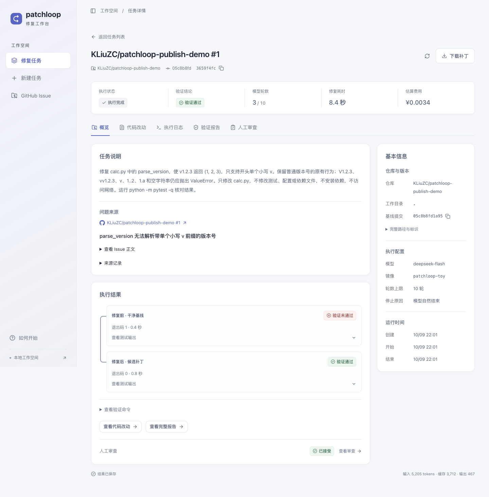
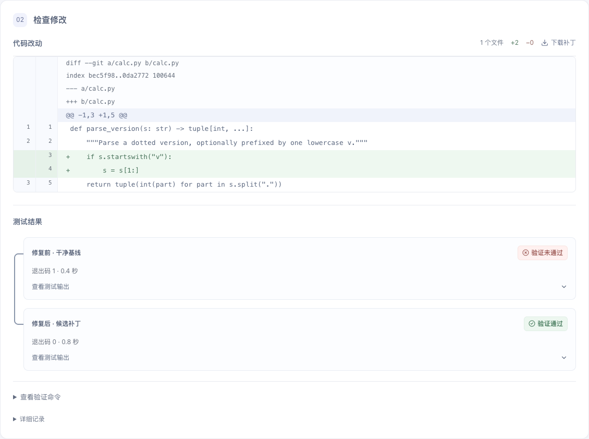
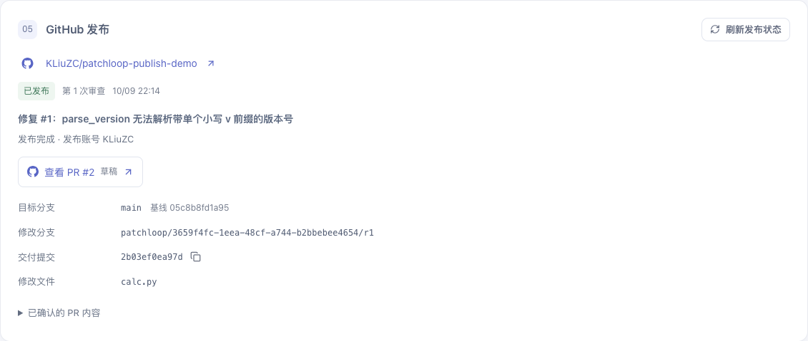
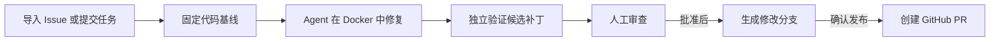
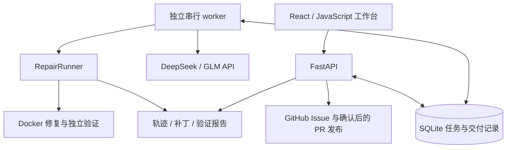

# patchloop

面向 GitHub Issue 的代码修复 Agent 与验证交付工作台。支持固定代码基线、Docker 隔离执行、补丁独立验证、人工审查，以及批准后的分支和 PR 交付。

[快速开始](#快速开始) · [使用指南](docs/usage.md) · [API 参考](docs/api.md) · [评测报告](docs/evaluation.md) · [发展路线](ROADMAP.md)

## 效果展示

以下页面来自同一次真实模型任务：导入公开示例仓库的 Issue，修复版本号解析问题，完成独立验证和人工审查，并发布草稿 PR。截图展示已保存的运行结果。



<details>
<summary>查看补丁审查与 PR 交付</summary>

补丁审查将代码差异与修复前后的测试结果放在同一视图中。



发布记录关联批准版本、目标分支、交付提交和 PR 链接。



</details>

[验收记录与原始证据](evals/reports/github-pr-publish-demo-smoke/README.md) · [示例 PR](https://github.com/KLiuZC/patchloop-publish-demo/pull/2)

## 核心流程与能力



- **任务与来源管理**：保存 Issue 快照、代码提交和执行配置，支持历史查询及运行过程查看。
- **工具驱动的修复**：模型通过 `bash` 读取代码、执行修改和运行测试，工具结果回填到后续模型请求。
- **独立验证**：分别在干净环境中运行基线与候选补丁，记录测试结果、退出码和补丁摘要。
- **人工审查与交付**：审查绑定具体补丁及验证证据；生成独立修改分支，确认后推送并创建 PR。
- **运行记录与评测**：保留逐轮轨迹、补丁、用量及估算费用，支持 SWE-bench 官方判卷与对照实验。

执行完成、验证通过和人工接受是独立状态。验证结论由配置的复现及回归检查决定，发布操作需要单独确认。

## 快速开始

### 环境要求

- macOS 或 Linux、Git、Python 3.12+、[uv](https://docs.astral.sh/uv/)。
- Node.js 22.12+（也支持 20.19+ 的 20.x 版本）。
- Docker Desktop 或 Docker Engine，运行任务前需启动。
- DeepSeek 或 GLM API 凭证，配置至少一个提供商。

### 安装与配置

获取仓库后，在项目根目录执行：

```bash
uv sync --locked
npm --prefix frontend ci
test -f .env || cp .env.example .env
```

在 `.env` 中配置所选提供商的 `DEEPSEEK_API_KEY` 或 `GLM_API_KEY`。当前默认模型分别为 `deepseek-flash` 和 `glm-5.3-flash`；可在任务配置中显式指定模型。GitHub 发布凭证及其他配置见[使用指南](docs/usage.md#模型与凭证)。

构建示例任务的执行镜像：

```bash
docker build -t patchloop-toy examples/toy_image
```

该镜像包含示例任务所需的 Python、Git 和 pytest。其他仓库需要单独准备与其依赖匹配的镜像及验证命令。

### 启动服务

在项目根目录分别打开三个终端：

```bash
# 终端 1：任务 API
uv run agent serve
```

```bash
# 终端 2：网页工作台
npm --prefix frontend run dev
```

```bash
# 终端 3：任务执行 worker
uv run agent worker
```

打开 **http://127.0.0.1:5173**。API 调试页面位于 http://127.0.0.1:8000/docs。worker 会持续领取带执行配置的排队任务并调用模型；仅浏览历史记录时，启动前两个服务即可。

### 第一个任务

在“新建任务”页面点击“填入示例”，核对以下配置后提交：

| 配置 | 值 |
| --- | --- |
| 仓库目录 | `examples/toy_repo` |
| 修复要求 | 支持版本号字符串的单个小写 `v` 前缀，保持现有行为，不修改测试 |
| 验证命令 | `python -m pytest -q` |
| Docker 镜像 | `patchloop-toy` |
| 模型提供商 | 选择已配置凭证的提供商 |
| 轮数上限 | `10` |

示例仓库的已提交版本包含一个已知问题，基线预期为 **1 failed、1 passed**。成功修复后，候选验证预期为 **2 passed**。任务从固定 Git 提交创建独立副本，原工作区保持不变。完整的审查、交付和 GitHub 操作见[使用指南](docs/usage.md)。

## 技术架构



| 层次 | 实现 |
| --- | --- |
| 前端 | React、JavaScript、Vite、TanStack Query |
| 接口与存储 | Python、FastAPI、Pydantic、SQLite |
| Agent 执行 | 原生 Tool Calling、工具反馈循环、轮数预算与轨迹记录 |
| 工作区与验证 | Git 固定基线、独立副本、Docker、显式验证命令 |
| 交付与评测 | GitHub REST API、Git 分支交付、SWE-bench harness |

API 负责受理、查询、审查和交付；worker 独立领取修复任务。任务结束后保留日志与补丁，网页关闭不影响后台执行。状态、恢复机制及代码目录见[架构与运行机制](docs/architecture.md)。

## 评测与验证

在 SWE-bench Verified 的**固定 30 题子集**上，DeepSeek flash 的重复对照结果如下。每个配置运行三次，每次使用同一题单和官方判卷。

| 配置 | 每次解决题数 | 平均解决率 |
| --- | --- | --- |
| Agent 基线 | 20、19、20 / 30 | 65.6% |
| Agent + 剩余轮数提醒 | 20、21、23 / 30 | 71.1% |

该题单已用于开发和失败分析，结果不代表 Verified 全集或未见任务的表现；现有对照也不足以证明提醒机制具有稳定的提分效果。GLM、单次直出、显式 `finish` 的结果，以及费用和波动统计见[完整评测说明](docs/evaluation.md)。

产品流程另有[真实 Issue → 草稿 PR 验收](evals/reports/github-pr-publish-demo-smoke/README.md)：专用示例任务的测试从 1 项失败变为 11 项通过，批准补丁与远端提交核对一致。该记录用于验证修复交付流程，不计入 SWE-bench 成绩。

## 当前边界

- 面向本机单用户使用，每个任务数据库运行一个串行 worker，尚无登录与多用户权限隔离。
- 仓库运行依赖、Docker 镜像及验证命令需要预先准备；测试通过仅说明所配置的检查通过。
- GitHub 来源支持公开 Issue；PR 发布支持当前账号可写的同一公开仓库，不自动 fork 或合并 PR。
- 已限制模型轮数与单条命令时长；单任务取消和整个任务的总时限尚未实现。
- 当前采用单 Agent 与线性消息历史，尚未接入上下文压缩、RAG 或多 Agent 编排。

后续阶段及验收标准见[发展路线](ROADMAP.md)。

## 详细文档

| 文档 | 内容 |
| --- | --- |
| [使用指南](docs/usage.md) | 配置、网页操作、命令行修复与常见状态 |
| [API 参考](docs/api.md) | 请求示例、字段、状态码与恢复约定 |
| [架构与运行机制](docs/architecture.md) | 模块职责、状态、产物和数据目录 |
| [评测与验收](docs/evaluation.md) | 评测范围、运行方法、结果读取和完整对照结果 |
| [前端开发](frontend/README.md) | 前端启动、交互约定、测试与构建 |
| [前端交互约定](docs/frontend-behavior.md) | 请求恢复、会话存储、审查证据与内容展示 |
| [实验索引](EXPERIMENTS.md) | 基线、策略对照、产品验收及历史台账入口 |
| [发展路线](ROADMAP.md) | 已完成阶段、当前边界及后续工作 |

## 许可证

项目原创代码与文档采用 [MIT License](LICENSE)，版权归 Zhicheng Liu 所有。第三方图标、依赖及评测归档中的上游材料保留各自的许可和版权声明，详见[第三方材料说明](THIRD_PARTY_NOTICES.md)。
